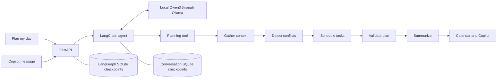

# Dayglow: FastAPI + LangGraph

Dayglow (LifeOSAgent) is an all-in-one personal dashboard. It keeps its existing coastal interface and now runs its **Plan my day** action through a persistent Python planning workflow.

## Existing website review

The frontend is plain HTML, CSS, and JavaScript ES modules; it does not use React or Next.js. `dist/index.html` contains the Today greeting, vertical navigation, calendar, work/home lists, Copilot conversation/activity panel, and downtime suggestions. `dist/styles.css` provides the responsive coastal theme. `dist/app.js` controls hash navigation, task completion, messages, and rendering.

Previously, the button returned a canned plan and inserted a fixed errands block. Task completion existed only in browser memory. The button now calls the Ollama agent through `/api/agent/plan`, and Copilot messages call `/api/chat`. Both send the same session ID and current completed tasks. The page structure, theme, vertical tabs, and minimal Today screen remain intact. Downtime suggestions remain sample content.

## Run locally

From this directory:

```sh
uv sync
uv run uvicorn backend.main:app --host 127.0.0.1 --port 8000 --reload
```

Open **http://localhost:8000**. FastAPI serves both the existing frontend and its API, so no separate frontend server is required. API documentation is at **http://localhost:8000/docs**. Python 3.11 or newer is required. No API key is needed.

Today initially shows the greeting and **Plan my day**. When planning finishes, Today reveals a compact summary and the calendar directly below the greeting. The previous schedule remains visible during replanning and after a failed request. On mobile, planning gently scrolls to the summary, respecting reduced-motion settings. Calendar remains available in its separate tab; Copilot shows the conversation and agent activity. Complete a task under Work/Home, then select **Replan my day** to exclude it. Reloading the same tab restores today's most recent plan, the submitted completion state, and the visible Today calendar.

Start the Ollama app and download `qwen3:8b` with `ollama pull qwen3:8b` before using the website's planner or Copilot. You can also test the endpoints in `/docs`: call `POST /api/agent/plan`, then `POST /api/chat` with the same UUID `thread_id` and a `message` asking about the schedule. These local model calls require no cloud API key. The existing `/api/plan` endpoint works without a running model.

Model requests have a five-minute browser timeout; data reads keep a 30-second timeout. While the agent is working, planning, chat and task checkboxes are disabled to prevent duplicate requests or changes to the submitted completion state. Chat returns the model's reply and, when its planning tool executes, also updates the calendar and activity from the structured plan. Errors are shown in the conversation and controls are restored. If a browser request times out, the backend may still finish; reload to check the saved plan before retrying.

## Backend and workflow

- `backend/repository.py`: calendar/work/home mock data readers. Replace these with actual service connectors later. API endpoints and the graph share this data boundary.
- `backend/main.py`: request validation, FastAPI endpoints, static frontend serving, and application-scoped SQLite checkpoint connection.
- `backend/planner.py`: typed graph state and explicit workflow nodes.
- `backend/agent_service.py`: LangChain/Ollama agent with request-scoped data tools, a scheduling tool, and persistent conversation history.
- `dist/api.js`: frontend service adapter. API calls default to the same origin. A separately hosted frontend can set `window.DAYGLOW_API_BASE` before loading the module; configure allowed origins on the backend too.



The graph retains its last request, context, plan, activity, and run count per `thread_id`. SQLite checkpoints survive server restarts. The browser keeps its session ID in `sessionStorage`; a new tab starts a new session. Each run explicitly replaces all request inputs, so a previous scenario override cannot leak into a subsequent plan. A lock serializes graph reads/writes within the single development server process.

Scheduling is deliberately **rule-based**, rather than LLM-generated: earlier deadlines first, then priority, followed by first available contiguous slot. All existing calendar commitments (including the lunch break) remain fixed. The planner finds every overlapping calendar pair, reports those conflicts for human resolution, and schedules new tasks around the occupied intervals. Tasks that cannot fit before their deadline are deferred with a reason. Completed tasks are excluded. Validation checks that newly scheduled blocks do not overlap existing commitments or one another.

The demo seeds four calendar blocks, four work tasks, and three home tasks for whichever day you request. All times are integer **local minutes after midnight** on that day, e.g. 540 is 09:00. The IANA timezone identifies the local clock; this sample does not convert external UTC events or support overnight events. Future connectors should normalize their events before passing them into the graph.

LangGraph uses a compiled `StateGraph` with a SQLite checkpointer, following the official [StateGraph reference](https://reference.langchain.com/python/langgraph/graph/state/StateGraph) and [persistence documentation](https://docs.langchain.com/oss/python/langgraph/persistence).

## API

| Method | Endpoint | Behavior |
| --- | --- | --- |
| GET | `/api/health` | Service status and planner mode |
| GET | `/api/calendar?date=2026-10-08` | Fixed commitments and protected lunch |
| GET | `/api/work?date=2026-10-08` | Work tasks, durations, priorities, windows |
| GET | `/api/home?date=2026-10-08` | Home tasks, durations, priorities, windows |
| POST | `/api/plan` | Invoke the graph and save its state |
| POST | `/api/agent/plan` | Ask Ollama to call the scheduler; return `{reply, plan}` |
| POST | `/api/chat` | Send a message to the agent; return `{reply, plan}` with `plan: null` when no new plan was generated |
| GET | `/api/plan/{thread_id}` | Retrieve saved graph state; 404 if absent |

Minimal request (omitting `thread_id` creates a new session):

```json
{
  "date": "2026-10-08",
  "timezone": "America/Los_Angeles",
  "completed_ids": ["w1"]
}
```

The response includes the session ID, run count, summary, scheduled task blocks, original calendar, conflicts, deferred tasks, and activity steps. Reuse the returned `thread_id` to replan in that session. Optional `calendar`, `work`, and `home` arrays support scenario inputs through the API documentation; an empty array means no data for that source. Omitted or null arrays use the mock readers. `day_start` and `day_end` bound the planning window, defaulting to 09:00–18:00.

The agent planning endpoint accepts the same fields and wraps the scheduler result in `plan`, alongside the model's `reply`. Tools supply exact readable clock labels to the model to reduce time-conversion mistakes; the structured `plan` is authoritative for calendar rendering. The chat endpoint additionally requires a `message` of 1–2000 characters. Send the current planning inputs, including completed task IDs, on each request. Conversation history is saved separately in `backend/data/api-agent-checkpoints.sqlite`, keyed by `copilot:{thread_id}`. Fresh data tools use the current request, including overrides and completed tasks. A separate agent lock serializes model requests for this single-process prototype. Model failures or a planning response without a successful scheduling tool call return HTTP 502. A model failure after scheduling can leave a saved planner result; inspect the saved-plan endpoint before retrying if needed.

For a conflict scenario in `/docs`, submit:

```json
{
  "calendar": [
    {"id": "meeting-a", "title": "Workshop", "start": 540, "end": 630},
    {"id": "meeting-b", "title": "Standup", "start": 600, "end": 660}
  ]
}
```

The result flags the overlapping appointments and places new tasks outside them. The planner never silently moves an appointment.

## Verification

```sh
uv run pytest -q
```

Fourteen backend tests cover source retrieval, actual graph execution, deadline/preferred-window scheduling, overlapping and nested appointments, insufficient time, adjacent appointments, completed-task replanning, session isolation, persistent restart recovery, rejected invalid inputs, and static frontend delivery.

For browser checks, install the optional development dependency and keep the server running:

```sh
npm install
npm run test:browser
```

The browser test uses installed Google Chrome in headless mode. It checks the agent planning request, resulting calendar, task completion/replanning, reload recovery, follow-up chat without keyword-triggered replanning, chat-generated plans, waiting controls, plain-text message rendering, failure recovery and mobile horizontal overflow. Screenshots are saved in `screenshots/`. Set `DAYGLOW_TEST_URL` to use a separate test server and `DAYGLOW_SCREENSHOT_DIR` to change the output directory. The test works with controlled model responses; running against live Ollama takes longer. Set `DAYGLOW_BROWSER_CHANNEL=chromium` if using an installed Playwright Chromium instead of Chrome.

## Scope and later integration

This is a local learning implementation with mock connectors and deterministic planning. It has no authentication or real calendar writes. Replace the repository readers with user-scoped connectors; an LLM node can later interpret goals or explain tradeoffs, while retaining the scheduling validation and checkpointing. Completed-task edits are saved with the next planning request, rather than written to an external task service.

SQLite data is stored at `backend/data/checkpoints.sqlite` (ignored by Git). Set `DAYGLOW_DB` to another file path when needed. Use one server process for this sample. A production service should add authenticated user/session ownership and use a production database/checkpointer.

The existing Sites deployment serves the earlier static prototype. This Python backend runs locally at port 8000; the hosted copy has not been replaced. Publishing this full workflow requires a Python-capable backend host and a configured frontend API URL.
